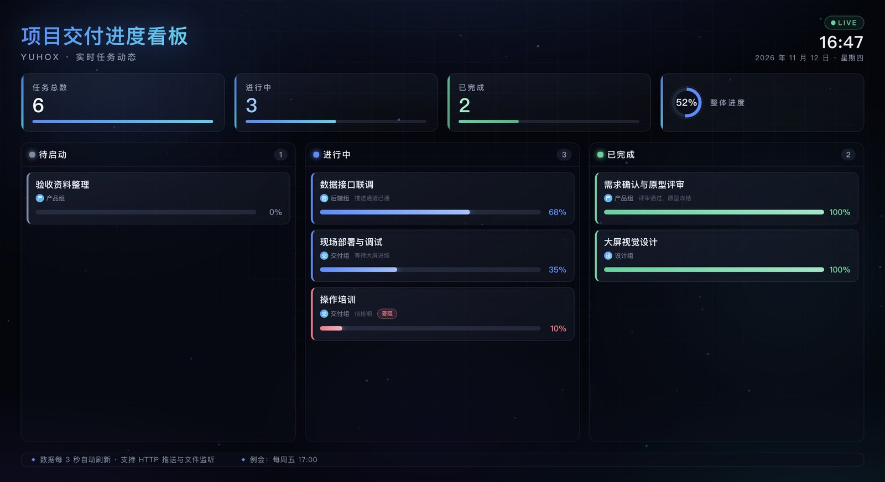
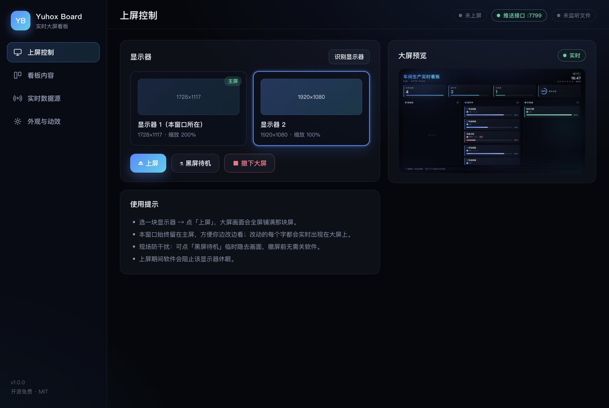

# Yuhox Board · 昱弘看板

**一块大屏，实时数据，一眼看完。**

开源免费的实时屏幕数据动态显示软件。控制台留在主屏，画面全屏钉到你指定的任意一块显示器上；任务进度、产线节拍、交付状态，改一个字、推一条数据，大屏立刻跟着动。

- 平台：Windows 10/11（x64），macOS / Linux 亦可运行
- 许可：MIT，商用免费，可二次开发
- 依赖：无服务端、无账号、无联网要求，素材与数据全部本地



## 它能做什么

| 能力 | 说明 |
|---|---|
| 指定显示器上屏 | 枚举所有显示器，选一块全屏输出；控制台仍在主屏，边改边看 |
| 三种实时数据通道 | 控制台手动编辑 / HTTP 接口推送 / JSON 文件监听，局域网任何机器都能推 |
| 两种大屏版式 | 泳道看板（按状态分列）、进度榜单（按完成度排序） |
| 动态视觉 | 粒子与极光背景、标题渐变、KPI 数字滚动、进度条平滑过渡、溢出自动循环滚动 |
| 现场可用性 | 黑屏待机、显示器热插拔自动回落、上屏期间阻止熄屏、断网照常运行 |
| 数据本地化 | 看板数据保存在本机用户目录，重启不丢，可导出 JSON 留档 |



## 快速开始

### 使用安装包

到 [Releases](https://github.com/mxyg/yuhox-board/releases) 下载 `YuhoxBoard-Setup-x.y.z.exe` 安装，或使用免安装的 `YuhoxBoard-Portable-x.y.z.exe`。

1. 双击打开，控制台出现在主屏。
2. 「上屏控制」里选中目标显示器（点「识别显示器」会在每块屏上闪编号）。
3. 点「上屏」，画面全屏铺满那块屏。
4. 「看板内容」里编辑任务，大屏实时跟随。

### 从源码运行

```bash
git clone https://github.com/mxyg/yuhox-board.git
cd yuhox-board
npm install
npm start
```

要求 Node.js ≥ 20。

### 打包 Windows 安装包

```bash
npm run dist:win     # 产物在 release/：NSIS 安装包 + 便携版
```

在 macOS 上交叉编译 Windows 包需要安装 wine。

## 实时数据接口

「实时数据源」里点「启动」，即在本机 `7788` 端口开一个 HTTP 接口（端口可改）。局域网内任何设备都能推数据。

```bash
# 推送任务（全量替换 tasks；title / subtitle / settings 可选）
curl -X POST http://192.168.1.10:7788/api/board \
  -H 'Content-Type: application/json' \
  -d '{
    "title": "车间生产实时看板",
    "subtitle": "一号线 · 当班",
    "tasks": [
      { "name": "装配工位", "owner": "甲班", "status": "doing", "progress": 82, "note": "节拍 42s" },
      { "name": "物料齐套", "owner": "仓储", "status": "done", "progress": 100 },
      { "name": "设备点检", "owner": "设备科", "status": "blocked", "progress": 20, "note": "待备件" }
    ]
  }'
```

```bash
# 读取当前看板
curl http://192.168.1.10:7788/api/board

# 健康检查
curl http://192.168.1.10:7788/api/health
```

`status` 取值：`todo`（待启动）、`doing`（进行中）、`done`（已完成）、`blocked`（受阻）。
`progress` 为 0–100 的整数。

网页端可以直接调（接口已开 CORS）：

```js
await fetch('http://192.168.1.10:7788/api/board', {
  method: 'POST',
  headers: { 'Content-Type': 'application/json' },
  body: JSON.stringify({ tasks: [{ name: '打包入库', owner: '丙班', status: 'doing', progress: 40 }] })
});
```

### JSON 文件监听

选一个 JSON 文件后，文件内容一变（保存即触发）大屏就更新。文件内容可以是任务数组，也可以是完整看板对象：

```json
[
  { "name": "焊接作业", "owner": "二班", "status": "doing", "progress": 55 }
]
```

适合配合 Excel 导出、Python 脚本、MES 落盘等任何能写文件的工具。

## 看板数据格式

```json
{
  "title": "项目交付进度看板",
  "subtitle": "YUHOX · 实时任务动态",
  "tasks": [
    { "id": "t1", "name": "需求评审", "owner": "产品组", "status": "done", "progress": 100, "note": "已冻结" }
  ],
  "settings": {
    "accent": "#4f8cff",
    "accent2": "#22d3ee",
    "showClock": true,
    "showSummary": true,
    "showNote": true,
    "autoScroll": true,
    "scrollSpeed": 36,
    "layout": "columns",
    "tickers": ["每周五 17:00 例会同步进度"]
  }
}
```

`layout`：`columns` 泳道看板 / `list` 进度榜单。`tickers` 为底部滚动字幕，每行一条。

## 技术架构

```
主进程 (src/main)
 ├─ 显示器枚举 / 输出窗口落位（screen API，无边框全屏）
 ├─ 看板状态唯一真源（store.js，落盘 userData/board.json）
 ├─ 本地 HTTP 推送服务（server.js）
 ├─ JSON 文件监听（fs.watch + 防抖）
 └─ 广播 board:updated / status:updated 到所有窗口
        │
        ├── 控制台窗口 (src/renderer/control)  编辑与指挥
        └── 大屏窗口   (src/renderer/output)   只渲染，不交互
```

- 大屏与控制台不共享页面状态，一切经主进程广播，多显示器 / 多窗口天然一致。
- 大屏窗口设置 `backgroundThrottling: false`，被遮挡时动画不降帧。
- 断网可用：除 HTTP 推送外无任何外部请求。

## 目录

```
src/main/index.js      主进程：窗口、显示器、IPC、文件监听
src/main/store.js      看板状态与持久化
src/main/server.js     HTTP 推送接口
src/preload/index.js   contextBridge 白名单
src/renderer/control   控制台
src/renderer/output    大屏
test/smoke.js          渲染冒烟测试（截图）
test/e2e.mjs           端到端测试（CDP 驱动）
```

## 测试

```bash
# 冒烟：渲染两个界面并截图到 test/
npx electron test/smoke.js

# 端到端：需先带调试端口启动应用
npx electron . --remote-debugging-port=9333 &
node test/e2e.mjs
```

## 发版

```bash
# 本机出 Windows 包（CI 会在 windows-latest 上做同样的事）
npm run dist:win

# 走公司运维台一键发布（编译台构建）
node ai.mjs release board --version 1.0.0 --notes "首次发布" --wait
```

## 许可

MIT License。允许商用、修改、再分发；请保留版权声明。见 [LICENSE](LICENSE)。

---

辽宁昱弘智能科技有限公司 · YUHOX
